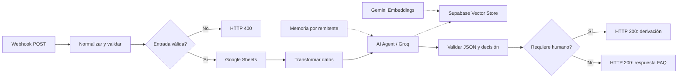

# PlayUZU — Asistente FAQ con IA, RAG y decisiones autónomas

**Proyecto académico — demostración con datos sintéticos.** No es un servicio de soporte en producción ni está conectado a cuentas reales de clientes.

## Objetivo

Automatizar respuestas a preguntas informativas frecuentes, apoyándose en datos operativos simulados de Google Sheets y en documentación sintética recuperada de Supabase mediante búsqueda vectorial. Derivar al soporte humano consultas individuales o sensibles y rechazar entradas inválidas.

## Arquitectura

Un segundo workflow realiza la **ingesta manual** de cinco textos sintéticos: Code → Default Data Loader → Recursive Text Splitter → Gemini Embeddings → Supabase Vector Store. Los embeddings y el almacén comparten 3072 dimensiones según los datos observados en la prueba; el modelo seleccionado es `models/gemini-embedding-001`.

## Estructura del repositorio

- `workflows/01-soporte-rag.json`: flujo principal (16 nodos, incluida nota informativa).
- `workflows/02-ingesta-faq.json`: flujo de ingesta (7 nodos, incluida nota informativa).
- `sql/schema_referencia.sql`: esquema de referencia, **no una exportación verificada de la base de datos actual**.
- `docs/RESULTADOS_Y_LIMITACIONES.md`: resultados observados y límites de la validación.
- `docs/CONFIGURACION.md`: cómo importar y ejecutar.
- `docs/ROI.md`: modelo de ROI con supuestos explícitos.
- `evidencias/`: diez capturas de ejecuciones reales y `INDICE.md` con descripción, alcance y advertencias de privacidad.

## Integraciones y decisiones

| Componente | Papel |
|---|---|
| Webhook n8n | Entrada HTTP POST y salida estructurada |
| Google Sheets | Estado operativo simulado de cuatro servicios |
| Groq (modelo `openai/gpt-oss-20b`) | Razonamiento y decisión del agente |
| Supabase + pgvector | Repositorio documental y búsqueda de similitud |
| Google Gemini Embeddings | Embeddings de consultas y documentos |
| Memoria por remitente | Clave de sesión `wa_` + número normalizado |

El agente entrega JSON con `decision` (`answer`, `clarify`, `escalate`), `answer`, `reason` y `source`. El validador aplica una respuesta segura si la salida no es JSON válido. El flujo envía las decisiones `escalate` por la rama de derivación; **`clarify` actualmente circula por la rama FAQ** porque el IF solo evalúa `requires_human`.

## Seguridad y alcance

- Datos sintéticos, sin acceso a cuentas, movimientos, credenciales ni pagos reales.
- Los JSON para GitHub omiten referencias a credenciales, identificadores internos de instancia y URL específica de Google Sheets.
- En una instalación real, configurar permisos mínimos, secreto de Webhook y políticas de acceso/RLS; actualmente el Webhook exportado muestra autenticación no configurada.
- Las credenciales secretas no se incluyen; conectarlas desde el gestor seguro de n8n.
- Evitar subir capturas con API keys, números personales o URLs privadas si no tienen autorización para publicarse.
- **No considerar este paquete listo para producción**: faltan pruebas de carga, autenticación del Webhook, persistencia de memoria, auditoría de permisos y validación de políticas de publicación.

## Reproducción

Seguir `docs/CONFIGURACION.md`. Los JSON se exportaron del prototipo probado y se limpiaron para publicación: será necesario volver a enlazar credenciales y la URL de la hoja. Los resultados de ejecución se describen como evidencia observada, no como pruebas automatizadas incluidas en el repo.

## Registro de evidencias adjuntas

Se incorporaron **10 capturas aportadas por el autor**. Consultar [`evidencias/INDICE.md`](evidencias/INDICE.md) para la correspondencia entre imágenes, pruebas y limitaciones. Antes de hacer público el repositorio, revisar URLs de prueba y metadatos visibles.
